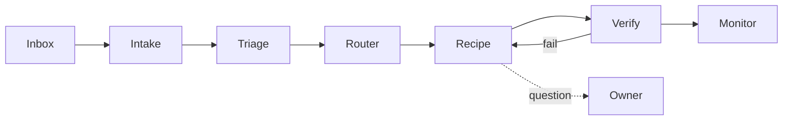

# Software Kitchen — Architecture

> Classify an input, apply the right recipe, verify, monitor.

## Principle

Mostly ordinary software. Models act only at named decision points; they never own the control loop.

## Flow

## Nouns

| Noun     | Meaning                                                |
| -------- | ------------------------------------------------------ |
| Input    | Raw inbox item, stored verbatim with its source.       |
| WorkItem | Classified Input: scope, repo, risk, recipe.           |
| Recipe   | A Mastra workflow; one per kind of job.                |
| Stage    | A Mastra step: typed input, typed output, one job.     |
| Run      | One WorkItem through one Recipe. Persisted, resumable. |

## Stage kinds

1. **Code**: git, lint, tests, API calls. Deterministic.
2. **Decision**: small model returns a structured choice.
3. **Session**: bounded coding-agent session in an isolated checkout.

## Rules

- Stages declare schemas; invalid output fails the stage.
- Verification is tests and CI, not a model's opinion.
- Every stage has attempt, time, and cost limits. At most two CI rounds.
- Waiting on CI or a human suspends the run; no worker sits idle.
- Asking the owner is a stage with one specific question.
- Repeated failure parks the WorkItem with a reason and next action.
- Prompts and context assembly live in the repo, versioned and readable.

## Build order

See `TIMELINE.md`. Each step runs boringly before the next starts.

## Safe to merge (draft)

A Dependabot bump may merge unattended only when every clause holds. Enforced by
`evaluateSafeRule` in `packages/kitchen/src/recipes/dependabot-bump/safe-rule.ts`; change both together.

1. Opened by Dependabot, open, not a draft, and bumping exactly one package.
2. Version change is patch or minor. Caret rules apply, so a 0.x minor counts as major. Prereleases,
   downgrades, and non-semver versions never qualify.
3. The local test script ran on the exact head commit and passed. A repo with no test script never qualifies.
4. CI on that commit reported at least one check, and every check passed, was neutral, or was skipped.
5. The decision model rated it `safe` with probability ≥ 0.8, and gave a breaking change a probability < 0.2.
6. The merge is pinned to the verified head commit (`--match-head-commit`).

The merge stage also requires `kitchen run --allow-merge` on that run.

## Open

- Accept or amend the draft safe rule above (timeline step 7). Should a package allowlist or denylist be added?
