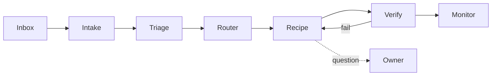
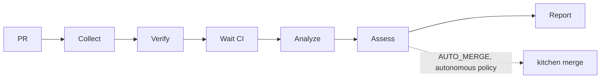

# Software Kitchen — Architecture

> Classify an input, apply the right recipe, verify, monitor.

## Principle

Mostly ordinary software. Models act only at named decision points; they never own the control loop.

## Flow

## Nouns

| Noun     | Meaning                                                |
| -------- | ------------------------------------------------------ |
| Input    | Raw inbox item, stored verbatim with its source.       |
| WorkItem | Classified Input: scope, repo, risk, recipe.           |
| Recipe   | A Mastra workflow; one per kind of job.                |
| Stage    | A Mastra step: typed input, typed output, one job.     |
| Run      | One WorkItem through one Recipe. Persisted, resumable. |

## Stage kinds

1. **Code**: git, lint, tests, API calls. Deterministic.
2. **Decision**: small model returns a structured choice.
3. **Session**: bounded coding-agent session in an isolated checkout.

## Rules

- Stages declare schemas; invalid output fails the stage.
- Verification is tests and CI, not a model's opinion.
- Every stage has attempt, time, and cost limits. At most two CI rounds.
- Waiting on CI or a human suspends the run; no worker sits idle.
- Asking the owner is a stage with one specific question.
- Repeated failure parks the WorkItem with a reason and next action.
- Prompts and context assembly live in the repo, versioned and readable.

## Build order

See `TIMELINE.md`. Each step runs boringly before the next starts.

## Safety assessment

Whether a dependency-update PR may merge unattended is decided by `assess` in
`packages/kitchen/src/safety/assess.ts`: pure code over normalized evidence and a versioned policy.
A model's confidence is never evidence. The model only reads release notes and picks rubric
criteria; the evaluator checks that each finding cites collected evidence, then prices it.

Collect reads git, the forge API, the npm registry, and advisory databases; it runs no PR code.
Verify runs install and tests only if the policy allows. Assess does, in order:

1. **Classify** the update (bot, ecosystem, manifest section, plain semver distance, 0.x, prerelease, grouped).
2. **Eligibility.** Default scope: GitHub, `renovate[bot]`, npm/pnpm, one stable patch of a
   `devDependency`. Anything else is ineligible (a human reviews it), not unsafe.
3. **Hard gates**: identity, change scope, dependency integrity, security, install behavior, release
   maturity, compatibility, CI, repository policy, evidence currency. Each is PASS, FAIL,
   INCONCLUSIVE, or NOT_APPLICABLE, with a disposition: `block`, `escalate`, `defer`, or
   `insufficient-evidence`. Missing data is never a pass.
4. **Rubric**: start at 100, deduct for evidence-backed findings (impact, dependency graph, release
   behavior, compatibility, verification, package history). Findings sharing a root deduct once.
   No grade without the required evidence.
5. **Decision**, by precedence: ineligible → HUMAN_REVIEW; block → BLOCK; escalate → HUMAN_REVIEW;
   defer → DEFER; insufficient evidence → INSUFFICIENT_EVIDENCE; then grade A (and the minimum
   score) → AUTO_MERGE, B/C → INVESTIGATE, D/F → HUMAN_REVIEW. No score lifts a failed gate.

The assessment records every gate, finding, deduction, evidence item (source, time, commit), the
policy version, and the evaluation time; the same input always yields the same assessment.

### Merging

Observation is the default: the kitchen records what it would do. A repository's policy can set
`mode: "autonomous"` and `automation.merge` (and `automation.approve` where reviews are required).
Even then the recipe never merges. `kitchen merge`, which holds a separate GitHub App identity:

- takes only AUTO_MERGE assessments the kitchen recorded, the latest per PR, never PR text;
- re-runs `assess` on the stored input and refuses if the result differs;
- refuses if the policy changed since, re-reads the PR with the App's token, and requires the same
  head, base, author, passing required checks, and a mergeable state; the App can't approve its own PR;
- approves (with `commit_id`) only when a review is required and allowed, then merges with `sha`, so a
  moved head fails the merge;
- never bypasses branch protection, rulesets, or merge queues; it reports a refusal instead.

With a GitHub App configured on a host, `config.json` must turn local tests off everywhere: PR code
never runs where merge credentials are.

## Open

- Calibrate the rubric with `kitchen eval` on real repositories before turning on `autonomous` anywhere.
- Merge queues: the kitchen refuses rather than enqueueing.
- A PR whose head moves after an AUTO_MERGE is not re-assessed until someone reruns it (timeline step 11).
