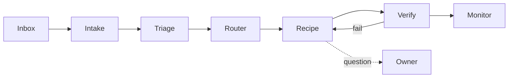

# Software Kitchen — Architecture

> Classify an input, apply the right recipe, verify, monitor.

## Principle

Mostly ordinary software. Models act only at named decision points; they never own the control loop.

## Flow

## Nouns

| Noun     | Meaning                                                |
| -------- | ------------------------------------------------------ |
| Input    | Raw inbox item, stored verbatim with its source.       |
| WorkItem | Classified Input: scope, repo, risk, recipe.           |
| Recipe   | A Mastra workflow; one per kind of job.                |
| Stage    | A Mastra step: typed input, typed output, one job.     |
| Run      | One WorkItem through one Recipe. Persisted, resumable. |

## Stage kinds

1. **Code**: git, lint, tests, API calls. Deterministic.
2. **Decision**: small model returns a structured choice.
3. **Session**: bounded coding-agent session in an isolated checkout.

## Rules

- Stages declare schemas; invalid output fails the stage.
- Verification is tests and CI, not a model's opinion.
- Every stage has attempt, time, and cost limits. At most two CI rounds.
- Waiting on CI or a human suspends the run; no worker sits idle.
- Asking the owner is a stage with one specific question.
- Repeated failure parks the WorkItem with a reason and next action.
- Prompts and context assembly live in the repo, versioned and readable.

## Build order

See `TIMELINE.md`. Each step runs boringly before the next starts.

## Open

- What makes a change "safe" to merge unattended? Decided at timeline step 7.
